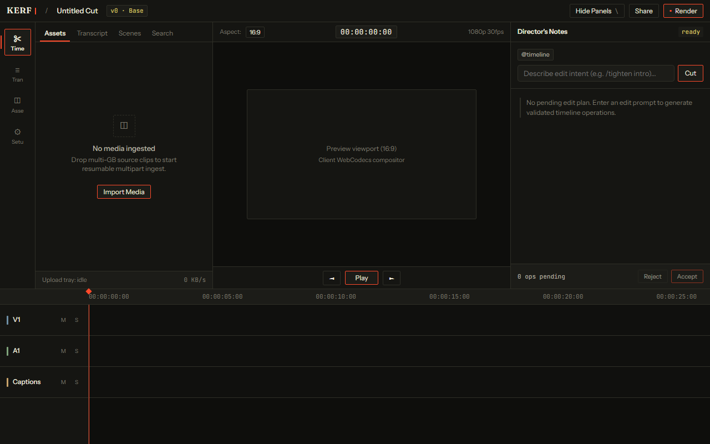
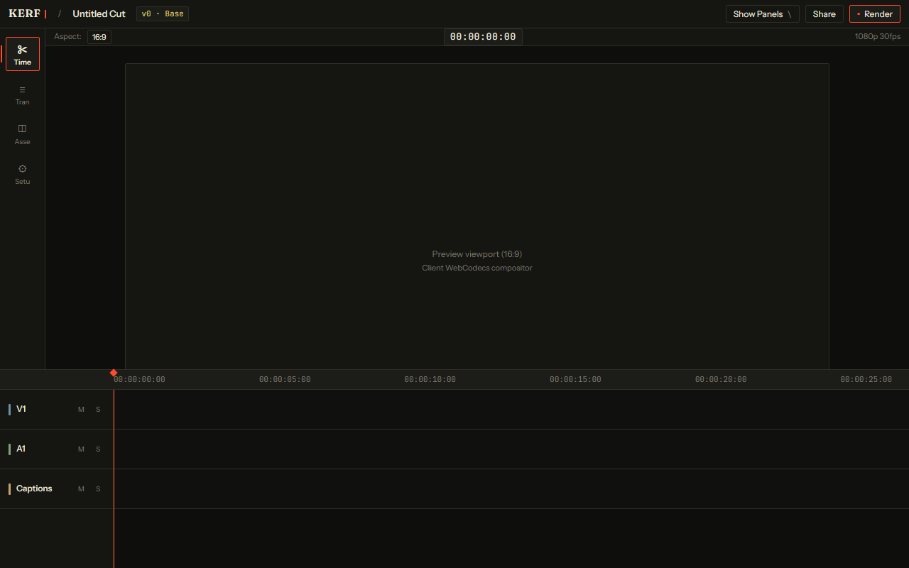
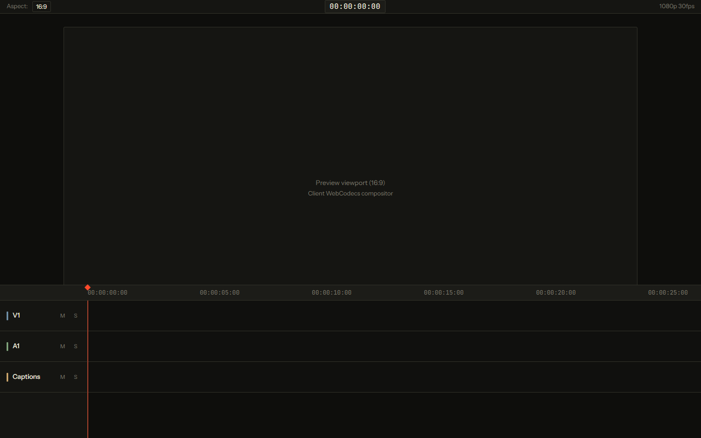
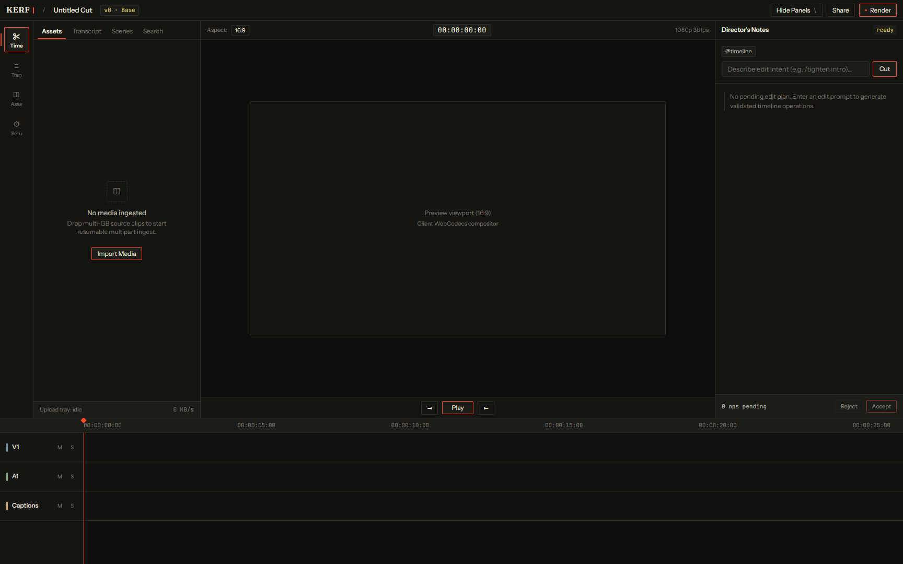
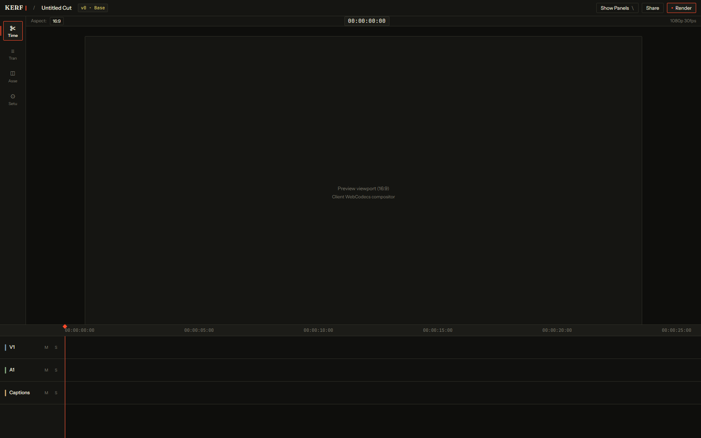
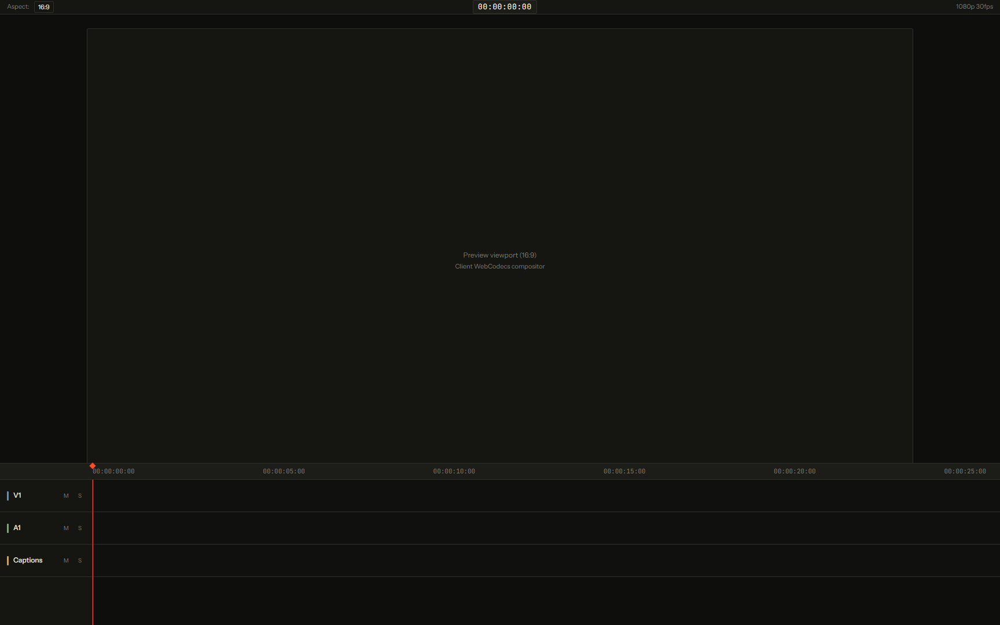
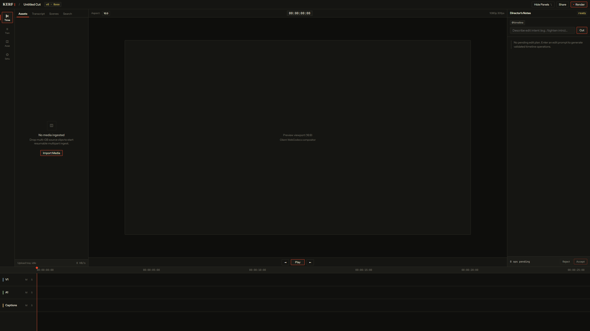
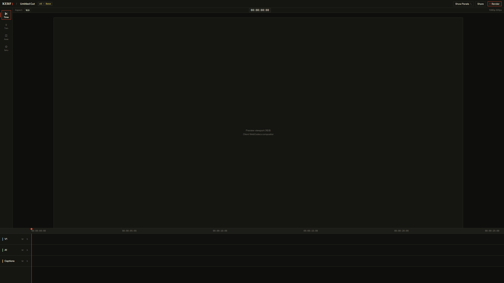
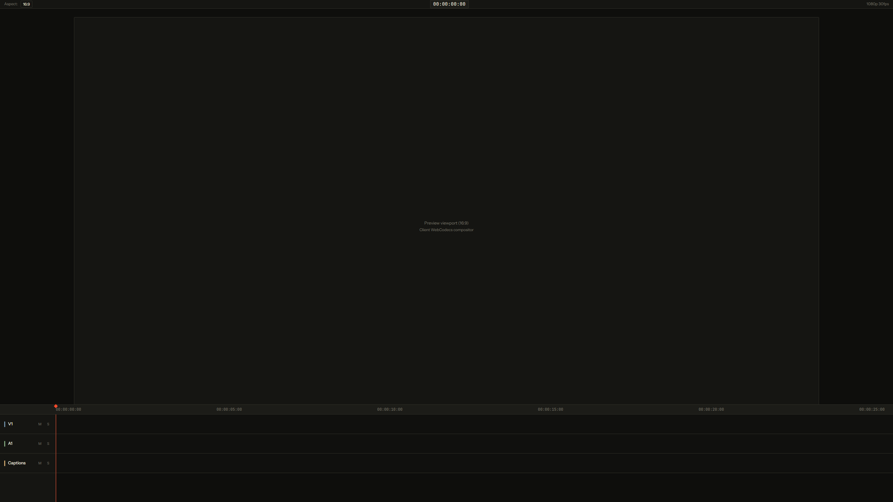

# UI Review & Contrast Audit Report

Generated automatically during Task 0.4 / Step 0d verification.

## 1. Font Audit
- **Instrument Sans**: Loaded
- **JetBrains Mono**: Loaded
- **Fraunces**: Loaded

## 2. Signature `--cut` Pixel Coverage Budget (< 3.0%)
| Viewport | Mode | File | Cut Pixels | Coverage (%) | Status |
|---|---|---|---|---|---|
| 1280px | default | `screenshot_1280_default.png` | 1369 | 0.1337% | PASS |
| 1280px | collapsed | `screenshot_1280_collapsed.png` | 743 | 0.0726% | PASS |
| 1280px | focus | `screenshot_1280_focus.png` | 311 | 0.0304% | PASS |
| 1728px | default | `screenshot_1728_default.png` | 1369 | 0.0734% | PASS |
| 1728px | collapsed | `screenshot_1728_collapsed.png` | 743 | 0.0398% | PASS |
| 1728px | focus | `screenshot_1728_focus.png` | 311 | 0.0167% | PASS |
| 2560px | default | `screenshot_2560_default.png` | 1369 | 0.0371% | PASS |
| 2560px | collapsed | `screenshot_2560_collapsed.png` | 743 | 0.0202% | PASS |
| 2560px | focus | `screenshot_2560_focus.png` | 311 | 0.0084% | PASS |

## 3. WCAG 2.1 AA Contrast Ratios (Normal Text ≥ 4.5:1, UI/Large ≥ 3.0:1)

| Background | Token | Hex | Ratio | Normal Text AA | UI / Large AA |
|---|---|---|---|---|---|
| `--bg-0` | `--text-0` | `#ECE9DF` | **15.91:1** | PASS | PASS |
| `--bg-0` | `--text-1` | `#B9B5A6` | **9.41:1** | PASS | PASS |
| `--bg-0` | `--text-2` | `#8D8A7D` | **5.58:1** | PASS | PASS |
| `--bg-0` | `--cut` | `#FF4A2B` | **5.77:1** | PASS | PASS |
| `--bg-0` | `--agent` | `#D8C46A` | **11.06:1** | PASS | PASS |
| `--bg-0` | `--track-video` | `#6E8FA6` | **5.65:1** | PASS | PASS |
| `--bg-0` | `--track-audio` | `#7FA37B` | **6.83:1** | PASS | PASS |
| `--bg-0` | `--track-music` | `#A98BB5` | **6.48:1** | PASS | PASS |
| `--bg-0` | `--track-caption` | `#C9A36A` | **8.22:1** | PASS | PASS |
| `--bg-0` | `--track-overlay` | `#B87C6B` | **5.64:1** | PASS | PASS |
| `--bg-1` | `--text-0` | `#ECE9DF` | **15.06:1** | PASS | PASS |
| `--bg-1` | `--text-1` | `#B9B5A6` | **8.91:1** | PASS | PASS |
| `--bg-1` | `--text-2` | `#8D8A7D` | **5.28:1** | PASS | PASS |
| `--bg-1` | `--cut` | `#FF4A2B` | **5.46:1** | PASS | PASS |
| `--bg-1` | `--agent` | `#D8C46A` | **10.47:1** | PASS | PASS |
| `--bg-1` | `--track-video` | `#6E8FA6` | **5.35:1** | PASS | PASS |
| `--bg-1` | `--track-audio` | `#7FA37B` | **6.47:1** | PASS | PASS |
| `--bg-1` | `--track-music` | `#A98BB5` | **6.14:1** | PASS | PASS |
| `--bg-1` | `--track-caption` | `#C9A36A` | **7.78:1** | PASS | PASS |
| `--bg-1` | `--track-overlay` | `#B87C6B` | **5.34:1** | PASS | PASS |
| `--bg-2` | `--text-0` | `#ECE9DF` | **14.07:1** | PASS | PASS |
| `--bg-2` | `--text-1` | `#B9B5A6` | **8.32:1** | PASS | PASS |
| `--bg-2` | `--text-2` | `#8D8A7D` | **4.94:1** | PASS | PASS |
| `--bg-2` | `--cut` | `#FF4A2B` | **5.1:1** | PASS | PASS |
| `--bg-2` | `--agent` | `#D8C46A` | **9.79:1** | PASS | PASS |
| `--bg-2` | `--track-video` | `#6E8FA6` | **5.0:1** | PASS | PASS |
| `--bg-2` | `--track-audio` | `#7FA37B` | **6.05:1** | PASS | PASS |
| `--bg-2` | `--track-music` | `#A98BB5` | **5.74:1** | PASS | PASS |
| `--bg-2` | `--track-caption` | `#C9A36A` | **7.27:1** | PASS | PASS |
| `--bg-2` | `--track-overlay` | `#B87C6B` | **4.99:1** | PASS | PASS |

## 4. Screenshots

### 1280px - default

### 1280px - collapsed

### 1280px - focus

### 1728px - default

### 1728px - collapsed

### 1728px - focus

### 2560px - default

### 2560px - collapsed

### 2560px - focus

